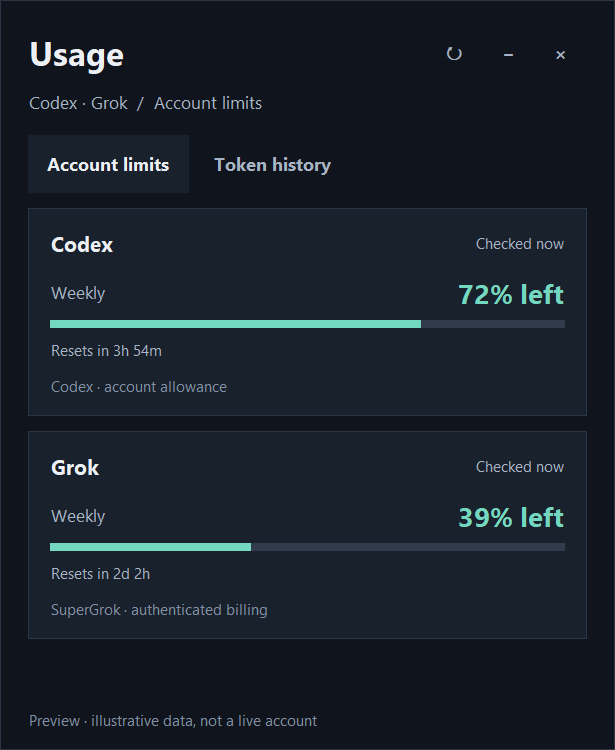

# API Usage

A small native Windows quota monitor for **Codex, SuperGrok, and Hermes token history**. Previously called Codex Usage Widget; existing shortcuts, settings location, and startup entries remain compatible.

No Electron, web server, or always-running browser is needed for Codex or Grok.




*Illustrative demo data; no account information is included in this screenshot.*

## At a glance

- **Account limits first:** one provider card, remaining allowance, reset time, and its own last-check timestamp.
- **Consistent bars:** the fill and headline both mean **remaining**, not opposing metrics.
- **Token history when needed:** a separate view with every recorded Hermes model, input/output/cache accounting, and the latest recorded session. Scrolling stays put when data refreshes.
- **Compact mode:** keep provider cards, reset times, refresh, and unavailable states without the history view.
- **Native desktop behavior:** draggable/resizable, system light/dark colors, DPI-scaled typography, hover details, tray menu, and optional always-on-top/startup.

## What the numbers mean

| Surface | Source | Meaning |
|---|---|---|
| Codex | Authenticated Hermes account-usage snapshot | Provider-published account/model allowance and reset windows |
| Grok | CLI credits API, then billing RPC if needed | SuperGrok included allowance; not developer API billing |
| Token history | Read-only Hermes SQLite database | Cumulative processed tokens, including cache accounting; not quota, dollars, or context occupancy |
| Gemini (optional) | Signed-in AI Studio Rate Limit table | 28-day RPM/TPM/RPD **peak**, not current headroom or Google AI Pro subscription usage |

**A missing number is not zero.** Grok can return valid billing dates but omit its usage percentage. The app tries the alternate endpoint, then shows **Not reported** with the known reset date if neither publishes a number. Protobuf cannot distinguish an omitted zero from an unpublished scalar; the UI deliberately avoids promising 100% headroom. An explicit zero is displayed normally.

A network failure keeps last-good numbers visibly **stale**, without changing their timestamp. Authentication failures ask for sign-in. Neither a local history refresh nor one healthy provider makes a failed provider look “Live.” The same states appear in compact mode and tray text.

## Requirements and installation

- Windows with Hermes installed locally and its Windows Python runtime available.
- Connect Codex and/or xAI OAuth **in Hermes**. This app does not collect passwords, keys, cookies, or MFA codes.
- The active `HERMES_HOME` is honored; otherwise the Windows per-user Hermes directory is used.

Download the `CodexUsageWidget-windows-x64` artifact from a successful [CI run](../../actions/workflows/ci.yml), extract it, and verify its accompanying ZIP checksum. Then run:

```powershell
powershell -ExecutionPolicy Bypass -File .\install.ps1 -SourceDir . -Launch
```

The installer stages and hash-verifies the package, gracefully stops only the existing widget, and retains a timestamped rollback directory and settings backup. It does not force-kill Hermes, install a Hermes plugin, enable startup, or need administrator rights. If graceful shutdown fails, installation stops without replacing the app.

To roll back, quit **API Usage** from the tray, preserve the current install directory, move the reported `.rollback-*` directory back to the installed location, and restore the reported settings backup if desired. Do not swap directories while the executable is running.

### Controls

- **↻ / Ctrl+R:** refresh account limits. Overlapping refreshes are coalesced.
- **− / +:** compact / expanded view; drag edges to resize.
- **× / Escape:** hide to tray, not quit.
- **Hover a bar:** used percentage, exact local reset timestamps, and available breakdown details.
- **Right-click tray:** show/hide, refresh, compact view, optional startup/topmost, provider Usage link, and Quit.
- Starting a second copy shows the existing instance rather than adding another tray icon.

## Lightweight polling

| Data | Visible | Hidden |
|---|---:|---:|
| Latest recorded session | 10 seconds | 60 seconds |
| Model totals | 60 seconds | 3 minutes |
| Provider quotas | 3 minutes | 10 minutes |

Failures retry after about a minute; an approaching reported reset can trigger an earlier check. Provider requests run independently in short-lived helpers. Local history is never blocked by a slow provider. Closing the app cancels only its own helper processes. Log rotation bounds disk use.

### Optional Gemini integration

Gemini uses the existing dedicated Bob Browser launcher at `<HERMES_HOME>/scripts/start-bob-browser.py` and loopback CDP port 9222. It can start that dedicated browser while an active Gemini credential exists. The adapter currently expects AI Studio account route `/u/1`; it is installation-specific, not a general Google sign-in manager. If that integration is absent or signed out, Gemini displays unavailable. Removing its current Hermes credential stops the collector; old model history never reactivates it. Collector-owned temporary tabs are closed after collection. Codex and Grok do not use a browser.

## Development

```powershell
uv venv .venv --python 3.11
uv pip sync --python .venv/Scripts/python.exe requirements.txt
.venv/Scripts/python.exe -m unittest discover -s tests -v
.venv/Scripts/python.exe build.py
```

`requirements.txt` is a hash-locked Windows dependency set. To refresh it deliberately:

```powershell
uv pip compile --upgrade --generate-hashes --python .venv/Scripts/python.exe requirements.in -o requirements.txt
```

Tests cover parser failures, missing versus explicit-zero usage, stale snapshots, provider removal, window selection, native compact/full/history transitions, tooltip lifecycle, scroll preservation, and tray shutdown. UI tests use synthetic fixtures with no network requests. `scripts/render_demo.py` generates the documentation preview from synthetic data only.

The build produces a one-directory executable, ZIP, ZIP SHA-256 checksum, and per-file `build-info.json` manifest. The standalone helper always loads its own bundled Codex adapter, not an older plugin left in the user's Hermes folder.

### Repository layout

- `app.py` — desktop lifecycle, tray/IPC, refresh coordination, preferences.
- `usage_ui.py` — quota/history native view.
- `data_client.py` — read-only local telemetry and independent sanitized collectors.
- `grok_quota_worker.py`, `quota_worker.py`, `gemini_quota_worker.py` — provider adapters.
- `hermes-plugin/` — legacy optional desktop pane and shared Codex normalizer. The pane is not installed by this app and is outside the standalone UI's feature/QA surface.

See [CHANGELOG.md](CHANGELOG.md) and [SECURITY.md](SECURITY.md). Grok billing interfaces are observed provider interfaces, not a guaranteed public API contract.

## License

MIT
